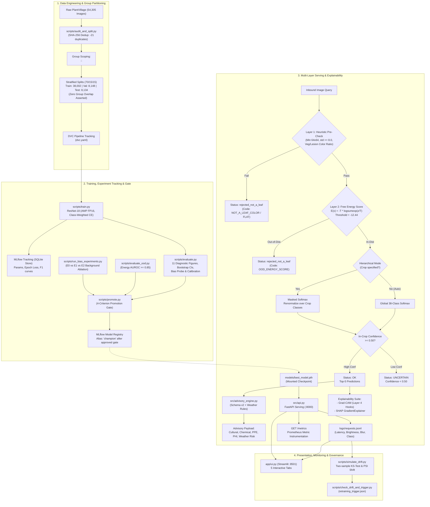
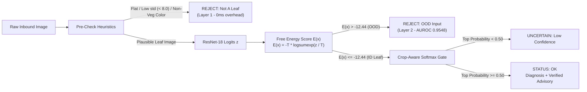

# System Architecture & Technical Specification

**Project**: Automated Crop Leaf Disease Identification and Precision Dosage Recommendation Pipeline
**Course**: B.Tech CSE-AI (Sponsored by Syngenta MLOps Evaluation Pilot)
**Status**: Prototype Engineering Pipeline (Phase 3 Expanded Evaluation-Grade)

---

## 1. End-to-End System Architecture

The pipeline adheres to modern MLOps principles, decoupling data versioning, neural training, model registration, containerized serving, selective prediction, and telemetry monitoring into auditable, reproducible stages:



---

## 2. Component Responsibilities

| Subsystem | Primary Module / Path | Key Technical Responsibility |
| :--- | :--- | :--- |
| **Data Audit & Partitioning** | `scripts/audit_and_split.py` | Detects SHA-256 exact duplicates, verifies class counts, groups multi-shot images via `<crop>::<source_code> <id>`, and outputs zero-leakage manifest CSVs. |
| **Foreground Segmentation** | `src/segmentation.py` | Implements Woebbecke Excess Green Index ($ExG = 2G - R - B$) with morphological opening and largest connected component extraction for background ablation. |
| **Model Architecture** | `src/model.py` | Instantiates ResNet-18 with ImageNet weights, replaces the final linear layer for 38 classes, and attaches forward/backward hooks on `layer4` for Grad-CAM. |
| **Experiment Tracker** | `scripts/train.py` | Implements automatic mixed precision (AMP FP16) training, class-weighted cross-entropy loss, cosine annealing, and records metrics to an SQLite-backed MLflow instance. |
| **Capture Bias Ablation** | `scripts/run_bias_experiments.py` | Benchmarks E0 (Baseline), E1 (Background-Randomized 80%), and E2 (Mixed 40/60) across clean, background-swapped, and center-masked evaluation sets. |
| **Out-of-Distribution Detector** | `src/ood_detector.py` | Multi-layered rejection engine: Layer 1 heuristic optical filtering + Layer 2 Helmholtz free energy score $E(x) = -T \cdot \log \sum \exp(z_i / T)$ preventing confident non-leaf misclassifications. |
| **Hierarchical Inference** | `src/api.py` (`/predict`) | Evaluates optional crop guidance; restricts prediction to genus/species candidate classes via masked softmax renormalization, resolving Potato vs. Tomato confusion. |
| **Explainability Suite** | `scripts/run_explainability.py` | Produces dual Grad-CAM and SHAP attribution heatmaps, calculates attribution mass on leaf foreground, and validates faithfulness via greedy pixel deletion curves. |
| **Model Registry & Gate** | `scripts/promote.py` | Enforces a provisional four-criterion gate: within-crop VAL macro-F1 retention, per-class recall floor, champion-relative masked-background drop, and ECE. |
| **Advisory Engine v2** | `src/advisory_engine.py` | Matches Schema v2 advisories from `kb/advisories.yaml` and foliar epidemiological risk from `kb/weather_rules.yaml` with negative constraint checks. |
| **Batch Inference Engine** | `scripts/batch_infer.py` | High-throughput batch inference engine processing image manifests via mini-batched tensors (110.5 fps single, 317.4 fps batch-64). |
| **Telemetry & Drift Engine** | `scripts/simulate_drift.py` & `check_drift_and_trigger.py` | Logs incoming query features (blur, brightness, latency), runs two-sample KS and PSI tests, and issues automated retraining trigger manifests upon drift breach. |
| **Reproducibility Harness** | `scripts/reproduce_check.py` | Validates strict deterministic forward passes, asserting zero logit divergence across identical seeds. |
| **Web Dashboard** | `app/ui.py` | Five-tab Streamlit dashboard offering Diagnostic Screening, Telemetry Monitoring, Bias Study Evidence, Coverage & Structural Gaps, and MLOps Governance. |

---

## 3. Layered Selective Prediction Architecture

A critical vulnerability identified in standard image classifiers is overconfidence on out-of-distribution (OOD) noise, grey tiles, or non-leaf objects:



---

## 4. API Contract & Schema Specification

The FastAPI serving service (`src/api.py`) exposes the following endpoints:

| Endpoint | HTTP Method | Input Parameters | Output Response |
| :--- | :--- | :--- | :--- |
| `/health` | `GET` | None | `{"status": "ok", "model_version": "v2", "device": "cuda", "champion_model": "models/best_model.pth"}` |
| `/predict` | `POST` | `file: UploadFile`<br>`crop: Optional[str]`<br>`temperature: Optional[float]`<br>`humidity: Optional[float]` | JSON containing `status` (`ok`, `uncertain`, `rejected_not_a_leaf`), `predicted_class`, `confidence`, `crop_mode`, `top5`, `advisory`, and base64 `gradcam_overlay`. |
| `/predict_batch`| `POST` | `files: List[UploadFile]`<br>`crop: Optional[str]` | JSON list of diagnosis payloads. |
| `/stats` | `GET` | None | Summary statistics of requests logged in `logs/requests.jsonl`. |
| `/metrics` | `GET` | None | Prometheus-formatted metric gauges and request counters. |

---

## 5. Process Lifecycle & Docker Compose

The production deployment runs via Docker Compose with continuous health monitoring and restart policies:

```yaml
services:
  api:
    build: .
    command: uvicorn src.api:app --host 0.0.0.0 --port 8000
    ports: ["8000:8000"]
    healthcheck:
      test: ["CMD", "curl", "-f", "http://localhost:8000/health"]
      interval: 10s
      timeout: 5s
      retries: 3
    restart: unless-stopped

  ui:
    build: .
    command: streamlit run app/ui.py --server.port 8501 --server.address 0.0.0.0
    ports: ["8501:8501"]
    depends_on:
      api:
        condition: service_healthy
    restart: unless-stopped
```
