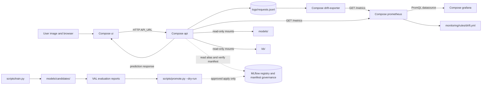

# System Architecture

This diagram reflects the repository's Compose services and configured data paths. It describes
the local demo stack and does not imply a deployed production environment.

Compose service nodes are `api`, `ui`, `prometheus`, `drift-exporter`, and `grafana`, from
`docker-compose.yml`. Prometheus scrapes the API and drift exporter using
`monitoring/prometheus.yml`; alert rules are loaded from `monitoring/rules/drift.yml`.

## Data flow

| Flow | Evidence | Behavior |
|---|---|---|
| Browser to API | `app/ui.py`, `docker-compose.yml` | Streamlit sends an uploaded image to the configured API URL. |
| Model load and health | `src/api.py`, `src/model_loader.py`, `models/champion_manifest.json` | API resolves serving identity and reports health; weights are read from the mounted model path. |
| Prediction audit log | `src/api.py`, `configs/config.yaml` | Request records go to the configured JSONL log; replay requests are labeled as replay. |
| Metrics to monitoring | `src/api.py`, `scripts/drift_exporter.py`, `monitoring/prometheus.yml` | Prometheus scrapes observed API and drift-exporter metrics. |
| Dashboard | `monitoring/grafana/` | Provisioned Grafana dashboards query the Prometheus datasource. |
| Candidate governance | `scripts/train.py`, `scripts/promote.py`, `src/promotion_safety.py` | Training writes candidate checkpoints; promotion has a dry-run and approval-gated apply path. |
| Drift trigger | `scripts/drift_exporter.py`, `monitoring/rules/drift.yml` | Real request-log windows can set the configured drift flag; replay traffic is staged. |

The Compose API mounts `models/`, `kb/`, and `reports/` read-only, `logs/` read/write, and
`mlflow.db` read-only. The UI mounts demo samples, reports, and logs read-only. Prometheus and
Grafana use named data volumes. Inspect `docker-compose.yml` for exact configuration.

## Deliberate boundaries

- `scripts/run_airflow_simulation.py` is a simulation; the repo does not establish a live Airflow
  scheduler or DAG execution.
- Drift checks can use real API logs, but replay is staged traffic and is not field traffic.
- `scripts/promote.py --dry-run` does not move the registry alias. Apply requires the configured
  governance checks; this documentation does not perform registry writes.
- The Streamlit interface has Diagnostic Screening, Production Telemetry, and MLOps System tabs,
  as defined in `app/ui.py`.
