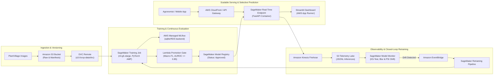

# Cloud Hyperscaler Architecture Mapping Guide

**Project**: Automated Crop Leaf Disease Identification and Precision Dosage Recommendation Pipeline  
**Course**: B.Tech CSE-AI (Sponsored by Syngenta MLOps Evaluation Pilot)  
**Objective**: Demonstrate how our local, zero-cost MLOps pipeline translates directly into enterprise hyperscaler cloud architectures across **Amazon Web Services (AWS)**, **Google Cloud Platform (GCP)**, and **Microsoft Azure**.

---

## 1. Architectural Component Mapping Matrix

| Local Engineering Component in Repo | AWS Cloud Equivalent | GCP Cloud Equivalent | Azure Cloud Equivalent | Production Rationale & Cloud Capabilities |
| :--- | :--- | :--- | :--- | :--- |
| **Data Versioning & Manifests** `data/splits/`, `dvc.yaml` | **Amazon S3** + **DVC Remote** / LakeFS | **Google Cloud Storage (GCS)** + Vertex Data | **Azure Blob Storage** / ADLS Gen2 | High-durability object storage maintaining immutability of image manifests and checkpoint weights. |
| **Experiment Tracking & Artifacts** `scripts/train.py`, `mlruns.db` | **Amazon SageMaker Experiments** / AWS Managed MLflow | **Google Vertex AI Experiments** | **Azure ML Tracking** (Hosted MLflow) | Centralized logging of hyperparameter curves, loss trajectories, and diagnostic artifacts across distributed runs. |
| **Training Engine (AMP FP16)** Local RTX 3050 Laptop GPU | **AWS SageMaker Training Jobs** (`ml.g5.xlarge`) | **Vertex AI Custom Training** (`n1-standard-4` + T4/A10G) | **Azure ML Compute Clusters** (`Standard_NC4as_T4_v3`) | Elastic, on-demand GPU instances running spot training with automatic checkpointing and scale-to-zero. |
| **Model Registry & Promotion Gate** `scripts/promote.py`, MLflow Registry | **Amazon SageMaker Model Registry** | **Vertex AI Model Registry** | **Azure ML Model Registry** | Versioned model artifact governance, enforcing multi-metric approval gates and lineage before deployment. |
| **Containerized Inference Serving** `src/api.py`, `Dockerfile` | **SageMaker Real-Time Endpoints** / **AWS ECS** / EKS | **Vertex AI Prediction** / **Google Cloud Run** | **Azure ML Managed Endpoints** / **Azure AKS** | Auto-scaling container serving with blue/green deployment, health probing, and low latency edge/cloud routing. |
| **Layered OOD & Selective Prediction** `src/ood_detector.py` | Custom Pre-processing Handler (`inference.py` in SageMaker) | Vertex Custom Prediction Routine (CPR) | Azure ML Scoring Script (`score.py`) | Pre-inference interception layer evaluating image heuristics and energy scores before invoking the neural head. |
| **Attribution & Explainability** Grad-CAM & SHAP (`run_explainability.py`) | **Amazon SageMaker Clarify** | **Vertex Explainable AI (XAI)** (Integrated Gradients) | **Azure ML Interpretability** | Cloud-native feature attribution pipelines computing Shapley values and feature importance at scale. |
| **Telemetry & Latency Audit** `logs/requests.jsonl`, Prometheus | **Amazon CloudWatch** + OpenTelemetry | **Google Cloud Logging & Monitoring** | **Azure Monitor** + Application Insights | Real-time distributed tracing, latency p99 monitoring, and structured JSON payload ingestion. |
| **Data Drift Detection & Monitoring** `simulate_drift.py` (KS & PSI) | **SageMaker Model Monitor** (Baseline vs Live) | **Vertex AI Model Monitoring** (Skew & Drift) | **Azure ML Data Drift Service** | Scheduled statistical drift monitors computing distribution distance on image embeddings, blur, and brightness. |
| **Automated Retraining Trigger** `check_drift_and_trigger.py` | **AWS EventBridge** + **SageMaker Pipelines** | **GCP Cloud Composer / Cloud Functions** + Vertex Pipelines | **Azure Event Grid** + **Azure ML Pipelines** | Event-driven trigger invoking continuous retraining and evaluation DAGs upon statistical drift threshold breaches. |
| **Interactive Dashboard & Telemetry UI** `app/ui.py` (Streamlit) | **AWS App Runner** / AWS ECS Fargate | **Google Cloud Run** | **Azure Container Apps** | Serverless container hosting for customer/agronomist screening portals with automatic TLS and DNS. |

---

## 2. End-to-End Enterprise Cloud Reference Architecture (AWS Example)

---

## 3. Cost-Optimization & Edge-Deployment Strategy

In real-world precision agriculture, field deployment presents unique network connectivity and hardware constraints:
1. **Edge Deployment with AWS IoT Greengrass / Azure IoT Edge**:
   - The ResNet-18 model checkpoint is lightweight (11.2M parameters, 128 MB uncompressed, $<50$ MB quantized via ONNX / TensorRT).
   - Local CPU inference takes **26.67 ms**, allowing local execution directly on an NVIDIA Jetson or tractor-mounted edge compute box without cellular backhaul.
2. **Hybrid Cloud Strategy**:
   - Daily high-throughput batch diagnostics (e.g. drone survey sweeps) run in the cloud via Batch Inference (`scripts/batch_infer.py` yielding 317.4 fps on GPU).
   - Real-time scout screening runs offline at the edge, syncing logged inference telemetry (`logs/requests.jsonl`) to cloud S3/GCS buckets when the scout reconnects to base Wi-Fi.
